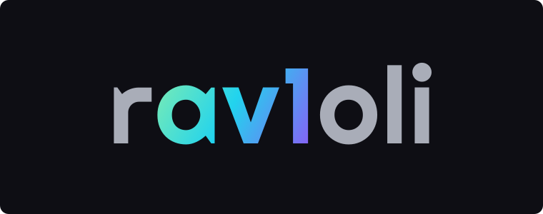

  

--- 

## About

Rav1oli is a wrapper around a [SVT-AV1-Essential](https://github.com/nekotrix/SVT-AV1-Essential) fork and [FFVship](https://codeberg.org/Line-fr/Vship/src/branch/main)
to use more advanced metrics, specifically CVVDP and Butteraugli to inform a second pass encode to better guide bits
where they're needed without inflating other areas.

This project IS NOT A SEPARATE ENCODER, it is simply a high level system in order to streamline the encoding steps.

**_A GPU is pretty much required to run this project, CPU driven metrics is not supported_**